# hiruzen-cli

[](https://github.com/farhanmalhi/hiruzen-cli/actions/workflows/ci.yml)
[](https://github.com/farhanmalhi/hiruzen-cli/releases/latest)
[](https://crates.io/crates/hiruzen-cli)
[](https://github.com/farhanmalhi/hiruzen-cli/releases)
[](LICENSE)

Your terminal assistant. As you type a command, hiruzen shows a dropdown of
what the next word can be (subcommands, options, branches, files, scripts)
and learns which ones you use, so the right one is usually first. You stay in
control: it suggests, you pick, and nothing runs until you press Enter. The
command it installs is `hiruzen`.



It is a single Rust binary with the completion specs embedded, so there is
nothing else to install. The only network requests are the registry searches
and the daily check for a new version described under
[Privacy and security](#privacy-and-security); a setting turns each off. It runs on macOS
and Linux with zsh, bash, fish and PowerShell, and on Windows with Windows
PowerShell 5 and cmd. PowerShell 7 and Git Bash on Windows build and pass
their tests, but are [not yet tried in a live terminal](docs/testing.md). If
hiruzen cannot start, your shell opens as normal.

Website: <https://hiruzen.farhanmalhi.com/>

## Contents

- [Install](#install)
- [Usage](#usage)
- [Settings](#settings)
- [Remote shells over SSH](#remote-shells-over-ssh)
- [Scripts](#scripts)
- [Plugins](#plugins)
- [Use with Claude Code](#use-with-claude-code)
- [Shell support](#shell-support)
- [Privacy and security](#privacy-and-security)
- [Limits](#limits)
- [Troubleshooting](#troubleshooting)
- [Uninstall](#uninstall)
- [Documentation](#documentation)
- [Scope](#scope)
- [Contributing](#contributing)
- [Credits](#credits)
- [License](#license)

## Install

### 1. Get the binary

Each [release](https://github.com/farhanmalhi/hiruzen-cli/releases) has a
prebuilt binary for macOS (Apple silicon and Intel), Linux (x64 and arm64)
and Windows (x64).

**macOS, with Homebrew** (this also works with Homebrew on Linux):

```sh
brew install farhanmalhi/tap/hiruzen
```

**Windows, with Scoop:**

```powershell
scoop bucket add hiruzen https://github.com/farhanmalhi/hiruzen-cli
scoop install hiruzen
```

**Linux and macOS, without Homebrew:**

```sh
curl --proto '=https' --tlsv1.2 -LsSf https://github.com/farhanmalhi/hiruzen-cli/releases/latest/download/hiruzen-cli-installer.sh | sh
```

**Windows, in PowerShell:**

```powershell
powershell -ExecutionPolicy Bypass -c "irm https://github.com/farhanmalhi/hiruzen-cli/releases/latest/download/hiruzen-cli-installer.ps1 | iex"
```

The two installer scripts download the binary for your machine, check it
against its SHA-256 checksum, put it in `~/.local/bin` (on Windows,
`%USERPROFILE%\.local\bin`) and add that directory to your `PATH`. Open a
new terminal afterwards. You can also download an archive from the release
page and put `hiruzen` on your `PATH` yourself.

**With Cargo.** You need a [Rust toolchain](https://rustup.rs), version 1.91
or newer:

```sh
cargo install --locked hiruzen-cli
```

Or, from a clone of this repository, `cargo install --locked --path .`.

This puts `hiruzen` in `~/.cargo/bin`, which must be on your `PATH`.

Whichever way you chose, check it:

```sh
hiruzen --version
```

### 2. Try it

Run `hiruzen` in a terminal. It starts your shell with suggestions switched
on and changes no files. Type `exit` to leave.

### 3. Start it with every new terminal

Run:

```sh
hiruzen install
```

This adds hiruzen to the startup file of every supported shell it finds; name
shells to limit it (`hiruzen install zsh`). Open a new terminal afterwards.

To do it by hand instead, add one line to the **end** of your shell's startup
file:

| Shell | File | Line to add |
| --- | --- | --- |
| zsh | `~/.zshrc` | `eval "$(hiruzen init zsh)"` |
| bash, Git Bash | `~/.bashrc` | `eval "$(hiruzen init bash)"` |
| fish | `~/.config/fish/config.fish` | `hiruzen init fish \| source` |
| PowerShell 7 | `$PROFILE` | `hiruzen init pwsh \| Out-String \| Invoke-Expression` |
| Windows PowerShell 5 | `$PROFILE` | `hiruzen init powershell \| Out-String \| Invoke-Expression` |
| cmd | none | Run `hiruzen --shell cmd`, or set it as the command line of a terminal profile |

The line only acts in an interactive shell that is not already inside
hiruzen. It does nothing if the `hiruzen` binary is missing, and if hiruzen
fails to start, the shell carries on without it. Scripts, `ssh host command`
and other non-interactive shells are not affected.

## Usage

### Keys

While suggestions are showing (these are the defaults; see
[Changing the keys](#changing-the-keys)):

| Key | Action |
| --- | --- |
| `Tab` | Accept the highlighted suggestion |
| `Down` / `Up` | Move the highlight |
| `Esc` | Hide suggestions for the current word |
| `Enter` | Insert the highlighted suggestion if you have moved the highlight; otherwise run the command as typed |

`Up` on the first suggestion goes to your shell's history as usual. While you
are browsing history with the arrow keys, suggestions stay hidden until you
type again. When no suggestions are showing, every key goes to your shell
unchanged, so `Tab` does your shell's own completion.

The dropdown shows up to eight suggestions at a time and scrolls through the
rest. It opens below the cursor, or above it when there is no room below.

### Commands

```
hiruzen [OPTIONS]              Start your shell with suggestions
hiruzen install [SHELL...]     Add hiruzen to your shell's startup file
hiruzen uninstall [SHELL...]   Remove it again
hiruzen integrations status    Show which shells start hiruzen
hiruzen init <SHELL>           Print the startup line, to add it by hand
hiruzen settings [KEY [VALUE]] List, read or change settings
hiruzen theme [NAME | --list]  Show or change the dropdown's colours
hiruzen run [NAME [key=value]] Run a saved script; with no name, list them
hiruzen scripts <ACTION>       Manage saved scripts: list, new, edit, show, remove, dir
hiruzen plugins <ACTION>       Manage shell plugins: list, add, remove, update
hiruzen evaluate               Measure suggestion quality against your own history
hiruzen ssh [SSH ARGUMENTS]    Connect with ssh and keep suggestions working remotely
hiruzen learn <COMMAND>        Teach hiruzen a tool it has no spec for, from its --help
hiruzen update                 Check whether a newer version has been released
hiruzen tips                   Show things worth knowing
hiruzen update [-y]            Check for a newer version and install it
hiruzen doctor                 Check that hiruzen is set up correctly
hiruzen issue [TITLE]          Open a new issue with your system details filled in
hiruzen complete <COMMAND>     Print the suggestions for a partly typed command
hiruzen --help | --version
```

`hiruzen install` with no shell named acts on every supported shell it finds.
It adds a marked block to the startup file (`~/.zshrc`, `~/.bashrc`, your
PowerShell profile, or its own file in fish's `conf.d`), and `uninstall`
removes exactly that block. `hiruzen doctor` checks the installation, the
settings file, each shell and the current terminal, and says how to fix what
it finds. `hiruzen issue` opens a GitHub issue form in your browser; nothing
is sent until you submit it.

| Option | Meaning |
| --- | --- |
| `-s`, `--shell <SHELL>` | Shell to start: `zsh`, `bash`, `fish`, `pwsh`, `powershell` or `cmd`. Default: `$SHELL` on macOS and Linux (bash if it is unset or not supported); on Windows, PowerShell 7 if installed, otherwise Windows PowerShell. |
| `-l`, `--login` | Start it as a login shell. |
| `--auto` | Exit quietly when hiruzen is already running or there is no terminal. Used by the line `hiruzen init` prints; you should not need it yourself. |

`hiruzen` exits with the exit status of the shell it ran, or with 2 if it
could not start.

### Checking what hiruzen knows

`hiruzen complete` prints the suggestions for a partly typed command without
starting a session. Use it to see what hiruzen offers for a tool, or to
report a problem:

```sh
hiruzen complete "git ch"
hiruzen complete "docker run --"
hiruzen complete "git checkout "         # trailing space: complete the next word
hiruzen complete --shell pwsh "git ch"   # as another shell would see it
```

It prints up to 30 suggestions, and exits with 1 when there is nothing to
complete at that position.

### Detecting a hiruzen session

Inside a session the environment variable `HIRUZEN` is set to `1`. Your own
startup scripts can test it.

## Settings

Settings live in one JSON file: `~/.config/hiruzen/settings.json` on macOS and
Linux (or under `$XDG_CONFIG_HOME`), `%APPDATA%\hiruzen\settings.json` on
Windows. Change them with `hiruzen settings`; a running session picks up the
change at its next prompt.

```sh
hiruzen settings                              # list every setting and its value
hiruzen settings docs                         # describe every setting
hiruzen settings autocomplete.height 12       # change one
hiruzen settings --delete autocomplete.height # back to the default
hiruzen settings open                         # open the file in your editor
```

| Setting | Default | Meaning |
| --- | --- | --- |
| `autocomplete.disable` | `false` | Turn suggestions off without removing hiruzen from your shell |
| `autocomplete.theme` | `dark` | Colours of the dropdown: `dark`, `light`, `dracula`, `nord`, `gruvbox`, `solarized` |
| `autocomplete.height` | `8` | Most suggestions shown at once, from 1 to 20 |
| `autocomplete.descriptions` | `true` | Show each suggestion's description beside it |
| `autocomplete.fuzzySearch` | `true` | Match anywhere in a suggestion, not only at its start |
| `autocomplete.history` | `true` | Rank and suggest using your shell history and hiruzen's own per-project record of what you run. `false` also stops the recording |
| `autocomplete.disableForCommands` | none | Commands that get no suggestions, for example `ssh,mysql` |
| `autocomplete.onlineSuggestions` | `true` | Let specs fetch suggestions from the network, such as package names from a registry: `npm install -g rea` lists matching packages. The dropdown shows `Searching online…` while it waits, and `No internet` when there is no connection. `false` means what you type stays on your machine |
| `keys.accept` | `tab` | Keys that insert the highlighted suggestion |
| `keys.next` | `down` | Keys that move the highlight down |
| `keys.previous` | `up` | Keys that move the highlight up |
| `keys.dismiss` | `escape` | Keys that hide suggestions for the current word |
| `autocomplete.enterAccepts` | `true` | Enter inserts the highlighted suggestion once you have moved the highlight with Up or Down. Until you move it, Enter runs the command as typed. Set to `false` to make Enter always run the command |
| `prompt.enable` | `true` | In zsh, replace the stock prompt with a coloured one that shows the directory and the git branch: `my-project (main) %`. With no branch checked out it shows the first seven characters of the commit. A prompt you or a theme set is never touched. Applies to new sessions |
| `prompt.showHost` | `false` | Start that prompt with your user and machine name: `you@host my-project (main) %` |
| `prompt.directoryLength` | `24` | Longest directory name the prompt shows, from 4 to 80. A longer name loses its middle: `my-very-long…oject-name-2` |
| `prompt.branchLength` | `80` | Longest branch name the prompt shows, from 4 to 80. The branch is shown whole unless the prompt would fill more than three quarters of the window; then it loses its middle: `feature/long-b…for-user-auth` |
| `updates.check` | `true` | Look for a new version once a day. When there is one, the next terminal you open asks `Update now? [Y/n]` and, if you agree, installs it the way hiruzen was installed (Homebrew, the installer script or cargo). A version you decline is not offered again; `hiruzen update` installs it whenever you like. `false` stops the checks |

`hiruzen theme --list` previews every theme, and `hiruzen theme nord` selects
one.

### Changing the keys

Each `keys.` setting takes one or more key names separated by commas:

```sh
hiruzen settings keys.accept "tab,ctrl+y"
hiruzen settings keys.next ctrl+n
hiruzen settings keys.previous ctrl+p
```

Key names are `tab`, `shift+tab`, `enter`, `escape`, `up`, `down`, `left`,
`right`, `pageup`, `pagedown`, `ctrl+space`, `ctrl+<letter>` and
`alt+<character>`. `ctrl+c`, `ctrl+d` and `ctrl+z` cannot be bound, because
they interrupt, end and suspend. A bound key acts only while the dropdown is
showing; otherwise it goes to your shell as usual. A key you unbind goes to
your shell too: with `keys.next` set to `ctrl+n` alone, Down walks shell
history again.

## Remote shells over SSH

Inside a hiruzen session, connect with `hiruzen ssh` in place of `ssh` and
suggestions keep working at the remote prompt:

```sh
hiruzen ssh me@server
hiruzen ssh -p 2222 -i ~/.ssh/key me@server
```

It takes the same arguments as `ssh`. To use it every time, add
`alias ssh='hiruzen ssh'` to your shell's startup file.

Nothing is installed on the other machine. hiruzen sends its small prompt
scripts inside the ssh command; they are written to a temporary directory
there and removed when you log out. hiruzen itself keeps running on your
machine and reads the remote prompt through the connection.

At a remote prompt, suggestions come from the specs and your history only:
subcommands, options and fixed argument values. File names, branches and
other live values are not offered, because hiruzen could only read them from
your own machine, where they would be wrong.

Remote bash, zsh and fish are supported; a machine with another login shell,
or without `mktemp` and `base64`, gets an ordinary login. Anything that is
not an interactive login (a remote command, a tunnel, `-N`, `-T`) is passed
to `ssh` unchanged, as is every call made outside a hiruzen session.

## Scripts

A script is a saved command with named blanks. Scripts are plain files in
`~/.config/hiruzen/scripts` (print the exact place with `hiruzen scripts dir`).

```sh
hiruzen scripts new restart     # create one and open it in $EDITOR
hiruzen run                     # list scripts
hiruzen run restart             # run it; you are asked for each blank
hiruzen run restart service=api env=prod
hiruzen run restart --print service=api   # show the command, do not run it
```

Comment lines at the top describe the script and its blanks:

```sh
# description: Restart a service
# param: service - Which service (choices: api, web)
# param: env=staging - Environment to act on
kubectl rollout restart deploy/{{service}} -n {{env}}
```

A blank with a default (`env=staging`) is optional. Values are inserted into
the command as typed, with no quoting, and the result runs in your shell as a
separate process, so a script cannot change the directory of the shell you
started it from.

## Plugins

hiruzen can load shell plugins (prompts, aliases, functions) into each new
shell. A plugin is a directory of shell code.

```sh
hiruzen plugins add https://github.com/zsh-users/zsh-autosuggestions
hiruzen plugins add ~/code/my-aliases         # a local directory, used in place
hiruzen plugins list
hiruzen plugins update                        # git pull the cloned ones
hiruzen plugins remove zsh-autosuggestions
```

Adding from a URL runs `git clone`, which uses the network because you asked
it to. Plugins load through the
`hiruzen init` line, so that line (or `hiruzen install`) must be in place. For
each shell hiruzen loads the plugin's conventional entry file:
`<name>.plugin.zsh` for zsh, `<name>.plugin.bash` or `<name>.sh` for bash,
`conf.d/*.fish` for fish, `<name>.psm1` or `<name>.ps1` for PowerShell.
Removing a plugin deletes only a directory hiruzen cloned; one added from a
local path is left untouched.

## Use with Claude Code

This repository is also a Claude Code plugin marketplace. The plugin lets
Claude look up a tool's valid subcommands and options with `hiruzen complete`
before it writes a command, so it does not guess at flags.

Install hiruzen first (above), then in Claude Code:

```
/plugin install hiruzen --marketplace farhanmalhi/hiruzen-cli
```

On Claude Code older than 2.1.275, use two steps:
`/plugin marketplace add farhanmalhi/hiruzen-cli`, then
`/plugin install hiruzen@hiruzen-cli`.

| Skill | What it does |
| --- | --- |
| `/hiruzen:cli-lookup` | Looks up what can follow a partly typed command. Claude also uses it on its own when unsure of a flag. |
| `/hiruzen:setup` | Installs, checks or removes hiruzen and changes its settings. Runs only when you ask for it. |

hiruzen also completes the `claude` command itself in your terminal: its
options, subcommands, and values such as `--permission-mode`.

## Shell support

| Shell | Platforms | History read from | Notes |
| --- | --- | --- | --- |
| zsh | macOS, Linux | `$HISTFILE`, otherwise `.zsh_history` in `$ZDOTDIR` or your home directory | |
| bash | macOS, Linux, Windows | `~/.bash_history` | On Windows, `bash` means Git Bash from [Git for Windows](https://gitforwindows.org) |
| fish | macOS, Linux | `fish/fish_history` under `$XDG_DATA_HOME` or `~/.local/share` | |
| PowerShell 7 (`pwsh`) | Windows, macOS, Linux | PSReadLine's `ConsoleHost_history.txt` | |
| Windows PowerShell 5 (`powershell`) | Windows | PSReadLine's `ConsoleHost_history.txt` | |
| cmd | Windows | none | Suggestions come from specs and live context only |

What has been tested on each platform, and what has not, is in
[docs/testing.md](docs/testing.md).

## Privacy and security

- hiruzen has no servers and collects nothing. The specs are inside the
  binary.
- Some specs look a word up online: `npm install reac` searches the npm
  registry for package names, and `cargo add` searches crates.io. This is on
  by default, and it means the word you are typing in that position is sent
  to that service. Nothing else on the command line is sent.
- Once a day hiruzen asks GitHub for the number of the latest release, so
  that it can offer to update. The request carries nothing about you or what
  you type, and nothing is installed until you answer yes.
  `hiruzen settings updates.check false` turns it off.
- To keep everything you type on your machine, run
  `hiruzen settings autocomplete.onlineSuggestions false`. Spec commands that
  exist to fetch from the network (`curl`, `wget` and similar) are then
  refused.
- Without a connection the dropdown says `No internet` and lists what your
  machine knows: options, files and your history. hiruzen then waits 20
  seconds before it tries the network again, so typing is not slowed.
- When online suggestions are on, hiruzen adds a User-Agent of
  `hiruzen/<version>` and its repository address to the `curl` calls specs
  make, unless the spec sets its own. Some services, crates.io among them,
  refuse requests that do not say who is asking.
- A tool's own listing command is always allowed, and may contact that
  tool's service: `gh` asks GitHub for your repositories, `kubectl` asks your
  cluster. hiruzen cannot tell which tools do this.
- Your shell's history file is read, never written. hiruzen reads its last
  20,000 lines at startup to learn which commands and subcommands you use.
- hiruzen keeps its own record of the commands you run, in `history.tsv` in
  its settings directory, readable only by you. Each line holds the command,
  the project it ran in, the time, which terminal it came from, and its exit
  status. Shell history has none of the last four, and they are what let
  suggestions follow the project you are in, ignore mistyped commands, and
  learn which command you usually run after another. The record holds up to
  20,000 commands. A command typed with a leading space is not recorded, and
  setting `autocomplete.history` to `false` stops both the reading and the
  recording. Delete the file to forget everything.
- Passwords and tokens are removed before a command is recorded. The value
  of an option or variable whose name says it is a secret (`--password`,
  `--token`, `API_KEY=`), the password in a URL, and anything shaped like a
  known service's token are replaced with `<redacted>`. This catches the
  common cases, not every secret; type a space first to keep a command out
  of the record entirely.
- hiruzen also keeps `picks.tsv`, which notes the suggestion you accepted
  and the ones listed above it, so it can learn your preferences. It holds
  suggestion names, not whole commands.
- If hiruzen itself fails while you are working, your shell keeps running:
  hiruzen stops drawing suggestions for that terminal and only passes your
  typing through. The failure is written to `crash.log` in the settings
  directory, which is worth attaching to a bug report.
- It runs local commands as you type. Live suggestions come from running
  read-only commands in the current directory: `git` to list branches, tags
  and changed files, and the listing commands that a tool's spec names (for
  example a spec may run its tool to list its resources). Each command has no
  input, is stopped after 3 seconds, and has its result reused for 4
  seconds. These commands come from the embedded spec library, not from the
  directory you are in.
- Spec code runs in a sandbox. Many specs compute suggestions with
  JavaScript: parsing a command's output, or choosing which command to run.
  hiruzen runs that code in an embedded JavaScript engine that has no file,
  network or timer access. The only thing the code can do is ask hiruzen to
  run a command, under the limits above.
- The integration scripts are written to a private
  directory (`hiruzen-<pid>` under the system temp directory, mode `0700` on
  macOS and Linux) and removed when the session ends.
- hiruzen starts PowerShell with
  `-ExecutionPolicy Bypass` so that its integration script can load. This
  applies to that PowerShell process only and does not change your system
  setting.

## Limits

- Suggestions are valid and well ranked, not guaranteed correct: hiruzen
  cannot know which of several valid words you intend.
- Suggestions appear only at a shell prompt, and not while the cursor is in
  the middle of a word. They are hidden inside full-screen programs such as
  `vim` and `less`.
- In a pipeline, only the last command is completed.
- Live suggestions depend on the tool being installed and able to answer.
  Kubernetes resource names, for example, need a reachable cluster, and a
  command that takes longer than 3 seconds gives no suggestions.
- Six tools in the library (`az`, `heroku`,
  `shopify`, `fig`, `infracost` and `@usermn/sdc`) build their whole spec in
  code at run time; hiruzen does not do that, so they have no built-in
  spec. `hiruzen learn az` builds one from the tool's own help.
- A tool hiruzen has never heard of gets suggestions from your history and
  the current folder until you run `hiruzen learn <command>`. hiruzen does
  not run an unknown program's `--help` on its own, because it cannot know
  what that program would do.
- Aliases complete as the commands they stand for in zsh and bash. In fish
  and PowerShell, aliases and functions are suggested by name only. cmd
  reports neither, and no exit statuses.
- Nushell, Xonsh and other shells not listed above are not supported.

## Troubleshooting

| Problem | What to do |
| --- | --- |
| `hiruzen: command not found` | Add the directory `hiruzen` was installed to (`~/.local/bin`, or `~/.cargo/bin` if you built from source) to your `PATH`, above the `hiruzen init` line in your startup file. |
| New terminals open without suggestions | Check that the `init` line is at the end of the startup file and that `hiruzen --version` works in that shell. Then run `hiruzen` by hand: it prints the reason if it cannot start. |
| `hiruzen: already running in this terminal` | You are inside a session already. Nothing more is needed. |
| `hiruzen: needs an interactive terminal` | hiruzen was started with its input or output redirected. Run it directly in a terminal. |
| `hiruzen: Git Bash was not found` | Install [Git for Windows](https://gitforwindows.org), or choose another shell with `--shell`. |
| `hiruzen: <shell> was not found on PATH` | Install that shell, or name one you have with `--shell`. |
| A tool you use has no suggestions at all | Run `hiruzen learn <command>`. It reads the tool's `--help` and builds suggestions from it. |
| A tool gives no suggestions, or wrong ones | Run `hiruzen complete "<what you typed>"` to see what hiruzen offers. Include that output when you report the problem. |
| A tool's live values are missing (branches, packages, resources) | Run the same `hiruzen complete` with `HIRUZEN_DEBUG=1` set. It prints each command the spec ran, with its exit status, and the error if the spec's own code failed. |
| You need a shell without hiruzen | Start one with the variable set, for example `HIRUZEN=1 zsh`. The `init` line then skips hiruzen. |

## Uninstall

1. Run `hiruzen uninstall`. If you added the `hiruzen init` line by hand,
   remove that line yourself.
2. Open a new terminal, then remove the binary the way you installed it:
   `brew uninstall hiruzen`, delete `hiruzen` from `~/.local/bin`
   (`%USERPROFILE%\.local\bin` on Windows), or run
   `cargo uninstall hiruzen-cli`.
3. Delete the settings directory if you changed any settings
   (`~/.config/hiruzen`, or `%APPDATA%\hiruzen` on Windows).

## Documentation

| Document | What it covers |
| --- | --- |
| [How hiruzen works](docs/how-it-works.md) | Where suggestions come from, how they are matched and ranked, and what hiruzen learns from you |
| [Measuring accuracy](docs/accuracy.md) | `hiruzen evaluate`, the results so far, and how they compare with published research |
| [What has been tested](docs/testing.md) | Platforms and shells tried, the edge-case suite, and what is still untested |
| [Changelog](CHANGELOG.md) | What changed in each release |
| [Security policy](SECURITY.md) | Supported versions and how to report a vulnerability |

## Scope

hiruzen does one thing: autocomplete. It reuses the spec library from Fig
(later Amazon Q Developer CLI) but is not a replacement for the rest of that
product. It has no dotfile sync, scripts, plugin store, AI command
generation, accounts, cloud sync or team features: hiruzen has no service
behind it and keeps everything on your machine. Settings, themes, saved scripts, shell plugins, a doctor
and shell integration management are built in, and work locally.

## Contributing

Contributions are welcome. [CONTRIBUTING.md](CONTRIBUTING.md) covers how to
report a problem, how to send a change, the development setup, the source
layout and how releases are made. `hiruzen issue` opens a bug report with
your system details filled in.

## Credits

The completion specs come from Fig's open-source spec library, and the
approach and shell integration scripts are adapted from Microsoft's
inshellisense. Both are MIT licensed; see
[THIRD_PARTY_NOTICES.md](THIRD_PARTY_NOTICES.md).

## License

[MIT](LICENSE) © The hiruzen authors.
